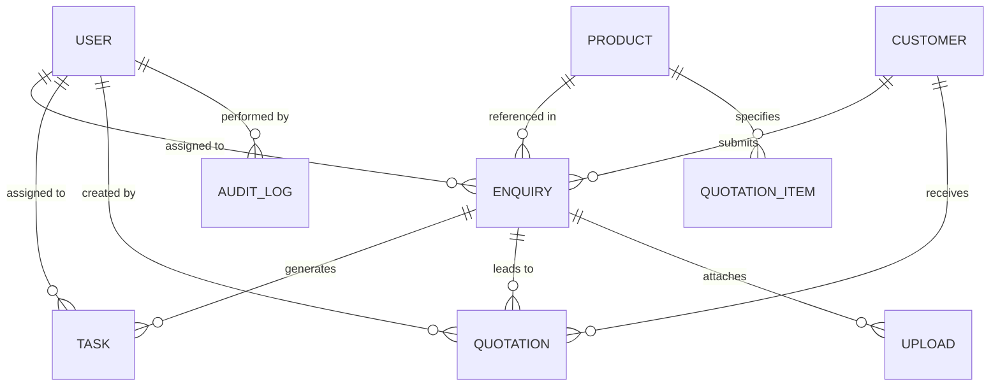

# DATABASE SCHEMA SPECIFICATION — MONGODB & MONGOOSE

This document details the MongoDB data models, indexes, relationship topology, and validation constraints for the Lotus Impex & Aeron industrial platform.

---

## 1. Schema Entity Relationship Diagram



---

## 2. Model Specifications

### 1. User (`users` collection)
Stores employee credentials, roles, and status for authentication and RBAC.

```typescript
{
  name: { type: String, required: true, trim: true },
  email: { type: String, required: true, unique: true, lowercase: true, trim: true, index: true },
  passwordHash: { type: String, required: true },
  role: { 
    type: String, 
    enum: ['super_admin', 'sales', 'accounts', 'inventory'], 
    default: 'sales', 
    index: true 
  },
  phone: { type: String, trim: true },
  isActive: { type: Boolean, default: true, index: true },
  lastLogin: { type: Date },
  createdAt: { type: Date, default: Date.now },
  updatedAt: { type: Date, default: Date.now }
}
```

### 2. Product (`products` collection)
Stores technical specifications for sanitary tubes, fittings, valves, and tank components.

```typescript
{
  name: { type: String, required: true, trim: true },
  sku: { type: String, required: true, unique: true, uppercase: true, trim: true, index: true },
  slug: { type: String, required: true, unique: true, lowercase: true, trim: true, index: true },
  category: { type: String, required: true, trim: true, index: true },
  priority: { type: Number, default: 50, index: true }, // 1 = highest display priority
  shortDescription: { type: String, required: true },
  fullDescription: { type: String, required: true },
  material: { type: String, required: true, default: 'Stainless Steel AISI 304 / 316L' },
  grade: { type: String, required: true, default: 'SS 304 / 316L', index: true },
  finish: { type: String, default: 'Ra < 0.8 µm (MP) / Ra < 0.4 µm (EP)', index: true },
  surfaceFinish: { type: String, default: 'Ra < 0.8 µm (MP) / Ra < 0.4 µm (EP)' },
  manufacturingType: { type: String, enum: ['Welded', 'Seamless', 'Forged', 'Cast'], default: 'Welded' },
  sizeRange: { type: String, required: true, default: '0.5" to 4" OD' },
  wallThickness: { type: String, default: '1.2mm to 2.0mm (16G - 14G)' },
  lengthOptions: { type: String, default: '6 Meters / Cut-to-length' },
  connectionType: { type: String, required: true, default: 'Tri-Clamp / Butt Weld / DIN / SMS' },
  standards: { type: String, default: 'ASTM A270, ASME BPE, DIN 11850, BS 4825' },
  applicableIndustries: { type: [String], default: [] },
  availabilityStatus: { 
    type: String, 
    enum: ['In Stock - Subject to Prior Sale', 'Standard Procurement 3-5 Days', 'Custom Fabrication'],
    default: 'Standard Procurement 3-5 Days'
  },
  mtcAvailable: { type: String, default: 'EN 10204 3.1 Mill Test Certificate Available' },
  images: { type: [String], default: [] },
  datasheetUrl: { type: String },
  specs: { type: Schema.Types.Mixed, default: {} },
  isPublished: { type: Boolean, default: true, index: true },
  isFeatured: { type: Boolean, default: false },
  seoTitle: { type: String },
  seoDescription: { type: String },
  isDemoItem: { type: Boolean, default: true },
  relatedProducts: [{ type: Schema.Types.ObjectId, ref: 'Product' }]
}
```
**Indexes:**
- Compound text index: `{ name: 'text', shortDescription: 'text', category: 'text', sku: 'text' }`
- Compound sort index: `{ category: 1, priority: 1, isPublished: 1 }`

---

### 3. Enquiry (`enquiries` collection)
Stores incoming RFQs from the public website, WhatsApp, or direct sales intake.

```typescript
{
  enquiryNumber: { type: String, required: true, unique: true, index: true }, // e.g. ENQ-20261015-0001
  customerName: { type: String, required: true, trim: true },
  company: { type: String, required: true, trim: true },
  email: { type: String, required: true, trim: true, lowercase: true, index: true },
  phone: { type: String, required: true, trim: true },
  whatsappNumber: { type: String, trim: true },
  country: { type: String, required: true, default: 'India', index: true },
  productRef: { type: Schema.Types.ObjectId, ref: 'Product' },
  productName: { type: String, trim: true },
  materialGrade: { type: String },
  sizeRequirement: { type: String },
  quantity: { type: Number, default: 1 },
  unit: { type: String, default: 'Pieces' },
  deliveryDestination: { type: String },
  requiredDate: { type: Date },
  message: { type: String, required: true },
  source: { type: String, default: 'website_rfq', index: true },
  status: {
    type: String,
    enum: ['new', 'contacted', 'quotation_sent', 'follow_up', 'negotiation', 'order_confirmed', 'lost', 'on_hold'],
    default: 'new',
    index: true
  },
  priority: {
    type: String,
    enum: ['low', 'medium', 'high', 'urgent'],
    default: 'medium',
    index: true
  },
  assignedUser: { type: Schema.Types.ObjectId, ref: 'User' },
  assignedUserName: { type: String },
  customerRef: { type: Schema.Types.ObjectId, ref: 'Customer', index: true },
  nextFollowUpDate: { type: Date },
  lossReason: { type: String },
  notes: { type: String },
  attachments: [{ type: Schema.Types.ObjectId, ref: 'Upload' }],
  activityHistory: [EnquiryActivitySchema],
  isDemoRecord: { type: Boolean, default: true }
}
```

---

### 4. Quotation (`quotations` collection)
Stores commercial price quotations generated for customer enquiries.

```typescript
{
  quotationNumber: { type: String, required: true, unique: true, index: true }, // e.g. QT-2026-0001
  revision: { type: Number, default: 0 },
  enquiryRef: { type: Schema.Types.ObjectId, ref: 'Enquiry', index: true },
  customerRef: { type: Schema.Types.ObjectId, ref: 'Customer', required: true, index: true },
  customerName: { type: String, required: true },
  company: { type: String, required: true },
  email: { type: String, required: true },
  phone: { type: String, required: true },
  billingAddress: { type: String },
  shippingAddress: { type: String },
  country: { type: String, default: 'India' },
  currency: { type: String, default: 'INR', enum: ['INR', 'USD', 'EUR', 'AED', 'GBP'] },
  lineItems: [{
    productRef: { type: Schema.Types.ObjectId, ref: 'Product' },
    productName: { type: String, required: true },
    sku: { type: String },
    description: { type: String },
    grade: { type: String },
    size: { type: String },
    quantity: { type: Number, required: true, min: 1 },
    unit: { type: String, default: 'Pieces' },
    unitPrice: { type: Number, required: true, min: 0 },
    discountPercent: { type: Number, default: 0, min: 0, max: 100 },
    lineTotal: { type: Number, required: true }
  }],
  subtotal: { type: Number, required: true },
  discountTotal: { type: Number, default: 0 },
  taxPercent: { type: Number, default: 18 }, // Standard GST or export 0%
  taxTotal: { type: Number, required: true },
  grandTotal: { type: Number, required: true },
  deliveryTerms: { type: String, default: 'Ex-Works Mumbai / CIF Destination upon agreement' },
  paymentTerms: { type: String, default: '100% advance against Proforma / LC at sight for exports' },
  validityDate: { type: Date, required: true },
  status: {
    type: String,
    enum: ['draft', 'sent', 'revised', 'accepted', 'rejected', 'expired', 'cancelled'],
    default: 'draft',
    index: true
  },
  notes: { type: String },
  createdBy: { type: Schema.Types.ObjectId, ref: 'User' },
  createdByName: { type: String }
}
```

---

### 5. Task / Follow-up (`tasks` collection)
Stores scheduled staff tasks, quotation follow-ups, and dispatch checks.

```typescript
{
  taskTitle: { type: String, required: true, trim: true },
  description: { type: String },
  assignedUser: { type: Schema.Types.ObjectId, ref: 'User', required: true, index: true },
  assignedUserName: { type: String },
  enquiryRef: { type: Schema.Types.ObjectId, ref: 'Enquiry', index: true },
  customerRef: { type: Schema.Types.ObjectId, ref: 'Customer' },
  dueDate: { type: Date, required: true, index: true },
  priority: { type: String, enum: ['low', 'medium', 'high', 'urgent'], default: 'medium', index: true },
  status: { type: String, enum: ['pending', 'in_progress', 'completed', 'cancelled'], default: 'pending', index: true },
  completedAt: { type: Date },
  completionNotes: { type: String }
}
```

---

### 6. Customer (`customers` collection)
Stores master business customer profiles deduplicated by email address.

```typescript
{
  name: { type: String, required: true, trim: true },
  company: { type: String, required: true, trim: true, index: true },
  email: { type: String, required: true, unique: true, lowercase: true, trim: true, index: true },
  phone: { type: String, required: true, trim: true },
  country: { type: String, default: 'India', index: true },
  address: { type: String },
  industry: { type: String },
  notes: { type: String },
  linkedEnquiries: [{ type: Schema.Types.ObjectId, ref: 'Enquiry' }],
  linkedQuotations: [{ type: Schema.Types.ObjectId, ref: 'Quotation' }]
}
```

---

### 7. Upload (`uploads` collection)
Stores metadata for secure, private files (BOQ spreadsheets, customer drawings).

```typescript
{
  fileId: { type: String, required: true, unique: true, index: true }, // UUID v4
  originalName: { type: String, required: true },
  storageFilename: { type: String, required: true },
  mimeType: { type: String, required: true },
  sizeBytes: { type: Number, required: true },
  category: { type: String, enum: ['boq', 'drawing', 'datasheet', 'mtc', 'catalog'], default: 'boq' },
  linkedEnquiry: { type: Schema.Types.ObjectId, ref: 'Enquiry', index: true },
  isPublic: { type: Boolean, default: false } // Customer BOQs are always false
}
```

---

### 8. AuditLog (`audit_logs` collection)
Immutable security and operational event log.

```typescript
{
  timestamp: { type: Date, default: Date.now, index: true },
  userId: { type: Schema.Types.ObjectId, ref: 'User' },
  userName: { type: String, default: 'System' },
  userRole: { type: String },
  action: { type: String, required: true, index: true }, // e.g. 'LOGIN', 'CREATE_QUOTATION'
  entityType: { type: String, required: true, index: true }, // e.g. 'enquiry', 'quotation'
  entityId: { type: String },
  details: { type: Schema.Types.Mixed },
  ipAddress: { type: String }
}
```

---

### 9. CompanySettings (`company_settings` collection)
Central business configuration holding configurable entity and brand names.

```typescript
{
  companyName: { type: String, default: 'Lotus Impex' },
  productBrand: { type: String, default: 'Aeron' }, // Configurable, NOT hardcoded
  email: { type: String, default: 'info@lotusimpex.com' },
  phone: { type: String, default: '+91 98200 00000' },
  whatsapp: { type: String, default: '+91 98200 00000' },
  address: { type: String, default: 'Unit 14, Industrial Area, Kanjurmarg West, Mumbai 400078, Maharashtra, India' },
  intro: { type: String },
  socialLinks: { type: Schema.Types.Mixed, default: {} },
  supportedLanguages: { type: [String], default: ['en', 'hi', 'de', 'ar', 'es', 'fr'] },
  defaultCurrency: { type: String, default: 'INR' },
  availableCurrencies: { type: [String], default: ['INR', 'USD', 'EUR', 'AED', 'GBP'] },
  whatsappWebhookVerified: { type: Boolean, default: false },
  isDemoConfig: { type: Boolean, default: true }
}
```
