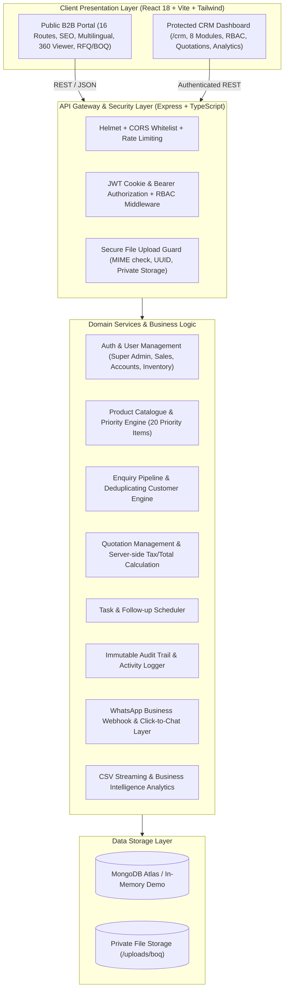

# IMPLEMENTATION PLAN — LOTUS IMPEX & AERON INDUSTRIAL PLATFORM

## 1. Project Overview & Vision
This document outlines the engineering implementation plan for the **Lotus Impex** public B2B digital portal and unified internal **Operational CRM**. The platform serves domestic and international engineering, procurement, and construction (EPC) clients across the pharmaceutical, biotechnology, dairy, food & beverage, brewery, chemical, and water-treatment industries.

### Core Business Guarantees & Constraints:
- **Provisional Entity Identity:** *Lotus Impex* (trading and distribution company, Mumbai, Maharashtra, India).
- **Configurable Product Brand:** *Aeron* (configurable through CRM Company Settings; not hardcoded as a permanent legal trademark).
- **Truth in Presentation:** No fabricated manufacturing facilities, fake certifications, or invented stock quantities. Transparent specification guidance with clear indicators for items subject to mill confirmation.
- **Unified Single-Stack Architecture:** MERN stack (MongoDB, Express.js, React 18, Node.js + TypeScript) sharing unified domain schemas without third-party CRM software dependencies.

---

## 2. System Architecture & Component Topology

---

## 3. Phased Implementation Roadmap

### Phase 1: Inspection & Baseline Verification [COMPLETED]
- Audited workspace repository, environment files, dependencies, and test suite.
- Verified 15/15 passing Vitest server integration tests.
- Verified clean client production bundle generation via `tsc && vite build`.
- Identified functional gaps against the Master Prompt (Quotations, Tasks/Audit logs, Secure BOQ uploads, WhatsApp Webhooks, 20 Priority Products, missing public routes).

### Phase 2: Architecture Documentation [IN PROGRESS]
- Author `IMPLEMENTATION_PLAN.md`
- Author `ROUTES.md`
- Author `DATABASE_SCHEMA.md`
- Author `API_DOCUMENTATION.md`
- Author `SECURITY_CHECKLIST.md`
- Author `SEO_CHECKLIST.md`
- Author `DEPLOYMENT.md`

### Phase 3: Backend Domain Models & REST API Expansion
1. Update `User.ts` model and middleware to support 4 roles: `super_admin`, `sales`, `accounts`, `inventory`.
2. Expand `Product.ts` model: add `sku`, `priority`, `finish`, `manufacturingType`, `wallThickness`, `lengthOptions`, `mtcAvailable`, `availabilityStatus`, `datasheetUrl`, `relatedProducts`.
3. Create `Quotation.ts` model, `quotationRoutes.ts`, `quotationController.ts`, `quotationValidator.ts` with server-side line item calculations, status workflows, and printable formatting.
4. Create `Task.ts` model, `taskRoutes.ts`, `taskController.ts` for unified follow-up management.
5. Create `AuditLog.ts` model, `auditLogRoutes.ts`, `auditLogController.ts` for compliance logging.
6. Create `Upload.ts` model, `uploadRoutes.ts`, `uploadController.ts` for secure BOQ and drawing uploads with path-traversal prevention and private access.
7. Create `whatsappRoutes.ts`, `whatsappController.ts` with webhook verification, message deduplication, customer matching, and graceful click-to-chat fallback.
8. Seed 20 Priority Products required by Section 6.D of Master Prompt with authentic dimensions, grades, and standards.

### Phase 4: Public Frontend Route Expansion & Industrial Design
1. Build missing public pages:
   - Category-Dedicated Landing Pages (`/products/:categorySlug`)
   - Industry Detail Pages (`/industries/:slug`)
   - Supply & Enquiry Process (`/supply-process`)
   - Media Gallery (`/media`)
   - Dedicated Request a Quote Page (`/request-quote`)
   - Dedicated Submit a BOQ Page (`/submit-boq`)
   - FAQ Page (`/faq`)
   - Privacy Policy (`/privacy`)
   - Terms & Conditions (`/terms`)
2. Upgrade 360° interactive viewer component with touch rotation, full-screen view, and clear fallback indicators.
3. Enhance WhatsApp CTA buttons across pipes ("Get Price on WhatsApp") and fittings ("Enquire for Size & Price") with pre-filled message payloads.

### Phase 5: CRM Frontend Module Expansion
1. Quotation Management module (`/crm/quotations`): Quotation builder, line item table, discount/tax calculations, PDF/print preview, status transition controls.
2. Tasks & Follow-up module (`/crm/tasks`): Due date categorization, priority tags, assigned employee filters.
3. Expanded Role Permissions UI in Staff management (`/crm/users`): Role assignment (`super_admin`, `sales`, `accounts`, `inventory`), account deactivation.
4. WhatsApp Integration and Audit Logs view in Settings (`/crm/settings`).
5. Enhanced Enquiry Pipeline with 8 stages (New, Contacted, Quotation Sent, Follow-up, Negotiation, Order Confirmed, Lost, On Hold).

### Phase 6: Multilingual, SEO & Accessibility
1. Verify English and Hindi dictionaries; ensure internationalization foundation is ready for German, Arabic (RTL layout ready), Spanish, French.
2. Embed JSON-LD structured data (`Product`, `Organization`) on public pages.
3. Ensure Core Web Vitals optimization, semantic markup, and WCAG AA contrast compliance.

### Phase 7: Verification & Quality Assurance
1. Run backend automated tests including quotation math and role-based checks.
2. Run client production build and TypeScript type-checking.
3. Validate API routes against documentation.
